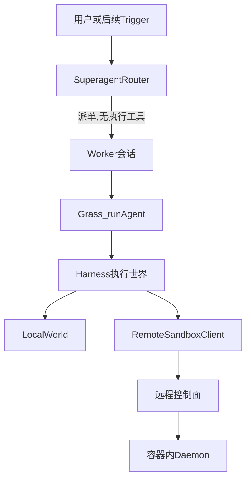

# Grass 之后的 Harness 与远程沙盒

状态：架构说明。执行世界、控制面和 daemon 已按这份契约落地。Agent 循环仍然不感知远程协议。

DeepSeek 把系统分成三层：Cordis 负责插件可装卸，Harness 负责包在模型外面的运行时，Super-agent 用一个常驻 Router 加多个隔离 Worker，解决「人同时只能盯住 3 到 5 个会话」。Grass 已经有循环这一层。下一步是在它后面加 Harness，让读写文件和执行命令指向同一块可替换的执行世界，并能够在远程服务器上创建一块云端开发环境。

来源：

- [DeepSeek Harness 与 Super-agent 技术报告整理](https://yukinoshitasherry.github.io/2611DeepSeekHarness/)
- [deepseek-harness architecture](https://github.com/deepseek-ai/deepseek-harness/blob/47f94385/docs/architecture.md)
- [进程沙箱](https://github.com/deepseek-ai/deepseek-harness/blob/master/docs/subsystems/sandbox.zh.md)
- [拆解 DeepSeek Super-agent](https://www.jungley.net/blog/2026-11-03-deepseek-super-agent-architecture-and-async-development/)

## Grass 已经有的

这些模块继续归 Grass，Harness 不重写它们：

| 模块 | 职责 |
| --- | --- |
| [src/agent/agent.ts](../src/agent/agent.ts) | 流式回合、工具结果配对、压缩只改发给模型的视图 |
| [src/agent/tools.ts](../src/agent/tools.ts) | `read_file` / `write_file` / `edit` / `edit_batch` / `run_bash` |
| [src/core/pathGuard.ts](../src/core/pathGuard.ts) | 展开路径、解析软链、拒绝工作区外的路径 |
| [src/session/sessionStore.ts](../src/session/sessionStore.ts) | 会话 SQLite，按 `sessionId` 隔离 |
| [src/agent/askUser.ts](../src/agent/askUser.ts) | 向用户提问。工具不碰终端，回答由调用方注入 |
| [src/cli.ts](../src/cli.ts) | 组装配置、会话、工具和界面 |

今天的缺口有两处。文件工具直接调用 `node:fs` 和 `child_process`，工作目录在 `builtinTools({ workspace })` 里一次绑死。路径沙箱是逻辑边界：它能拦住 `../` 和软链，挡不住同一台机器上的进程逃逸。远程开发环境因此无处安放。

## 从 DeepSeek 取走的四条

1. **一个执行世界。** 文件系统和子进程指向同一块根。换到远程沙盒时，读、写、改、跑命令一起搬走，工具定义不分叉。
2. **沙盒和审批分开。** 沙盒回答「能碰到哪些资源」。审批回答「要不要人点头」。隔离后端不可用时直接失败，不退回宿主机执行。
3. **Router 不执行。** Worker 才有执行工具。委派靠工具注册表，不靠提示词。DeepSeek 的消融里，只靠提示词劝主会话委派，完成时间的 p95 仍约 29 分钟。
4. **算力、状态、环境分开。** 会话库留在 Grass 这边。沙盒里只放仓库、工具链和命令结果。删掉容器不会丢掉对话。凭据以引用进入配置，值留在控制面宿主机，不进模型上下文，也不进容器环境变量。

Cordis、Profile/Bundle 热插拔、用事件溯源重写会话、多渠道、Chain of Recall、用另一个模型会话当 Watchdog，这一版不引进。Grass 的单向依赖和「工具不碰 context」继续有效。

## 四层



- **Grass** 继续只做回合、配对、压缩和会话。它收到的仍是现在的 `AgentTool[]`。
- **Harness** 是 Grass 后面的一层，负责「手」。对外一个 `ExecutionWorld`。本地实现包住现有 `PathGuard` 和命令执行。远程实现把同一次调用送到沙盒。
- **沙盒控制面** 跑在用户自己的 Linux 服务器上，默认后端是 Docker。它创建、探活、销毁云端开发环境。容器里的 daemon 只懂文件和命令。
- **Super-agent** 画在架构里，这一版不写代码。Router 是一个不带执行工具的 Grass 会话。每个 Worker 是另一个 Grass 会话，绑定自己的 `ExecutionWorld`。

依赖方向：`cli.ts` 组装 Harness，再把工具交给 `runAgent`。`agent.ts` 不 import 远程协议。控制面的 Docker 类型不出现在 Grass 进程里。以后换 Firecracker 或 Kubernetes，只换控制面。

`ask_user` 留在组装层，不属于执行世界。它占用的是人的输入通道，不是沙盒里的文件。

## 执行世界

工具工厂改为接收 `ExecutionWorld`，注入方式和现在的 `PathGuard` 相同。`execute` 仍然是 `(args) => Promise<string>`，不读取 agent context。

```ts
type SandboxMode = 'read-only' | 'workspace-write' | 'danger-full-access'

/** 文件和命令读同一份根。mode 跟每次调用走，不在工具里各写一套。 */
type SandboxPolicy = {
  mode: SandboxMode
  /** 已解析软链的工作区真实根 */
  workspaceRoot: string
}

type Edit = { old_string: string; new_string: string }

type ExecRequest = {
  /**
   * 即将执行的 argv，不是再包一层 shell 的字符串。
   * run_bash 传入 ['bash', '-c', command]，daemon 原样执行。
   */
  argv: readonly string[]
  cwd: string
  timeoutMs: number
}

type ExecResult = {
  exitCode: number
  stdout: string
  stderr: string
  aborted: boolean
  timedOut: boolean
}

interface ExecutionWorld {
  /** 本地世界为 null。远程世界是控制面返回的 sandboxId。 */
  readonly sandboxId: string | null
  readonly workspaceRoot: string
  readonly policy: SandboxPolicy
  read(filePath: string): Promise<string>
  write(filePath: string, content: string): Promise<void>
  /**
   * 按顺序做唯一替换，全部成功才落盘。
   * 任一处找不到或不是唯一匹配时，文件保持原样。
   */
  edit(filePath: string, edits: readonly Edit[]): Promise<void>
  exec(request: ExecRequest, signal?: AbortSignal): Promise<ExecResult>
}
```

三种模式：

| 模式 | 文件 | 命令 |
| --- | --- | --- |
| `read-only` | 可读工作区，拒绝写和 `edit` | 工作区对这次调用不可写。后端做不到这一点就拒绝 `exec`，不靠解析命令判断它会不会改文件 |
| `workspace-write` | 可写工作区 | `cwd` 锁在工作区。这是云端开发环境的默认 |
| `danger-full-access` | 绕过 seam | 只有调用方明确要求绕过时才存在。普通工具构造不出这种世界 |

客户端先做路径展开和越界判断，给模型一条和今天 `PathOutsideWorkspaceError` 相同的错误，省掉一次往返。daemon 再用工作区真实路径做一遍，拒绝软链、`..` 和工作区外路径。两边的比较规则沿用 [src/core/pathGuard.ts](../src/core/pathGuard.ts)：先 resolve，再 realpath，用 `path.relative` 判断包含关系。

`edit` 放在世界上，是为了让「检查唯一匹配」和「写入」发生在拥有字节的那一侧。远程若拆成先读后写，两次往返之间文件可能变。`edit_batch` 的顺序应用和原子性保持现在 [src/agent/tools.ts](../src/agent/tools.ts) 的语义：全部成功才写，失败则文件不变。单次 `edit` 是长度为 1 的 `edits`。

截断也跟着世界走。今天 `truncateOutput` 把全文写到 Grass 宿主机的临时目录。远程调用若仍写宿主机，模型拿到的路径在沙盒里不存在。超长的文件和命令输出截取尾部，完整内容留在该世界自己的临时区，返回文本里的路径必须能被同一个 `ExecutionWorld` 再次读到。

同一进程里的改文件排队仍由 [src/core/mutationQueue.ts](../src/core/mutationQueue.ts) 负责。一个 Grass 进程绑定一个世界时，这把锁够用。两个进程共用一个 `sandboxId` 不在这一版的契约里。

### 审批

审批是另一个接口，不塞进 `PathGuard`。

```ts
type ApprovalDecision = 'allow' | 'deny' | 'unavailable'

interface ApprovalGate {
  decide(action: {
    kind: 'write' | 'edit' | 'exec' | 'escalate'
    summary: string
  }): Promise<ApprovalDecision>
}
```

`escalate` 指离开当前策略的动作：把模式改成 `danger-full-access`、增加挂载、增加网络放行目标、把端口公布到容器外。没有审批实现时，这些动作得到 `unavailable`，Harness 把它当成拒绝，不执行。

工作区内的读写和命令由沙盒策略决定，不靠解析 shell 字符串猜测「这条命令会不会访问网络」。网络边界在容器上：默认拒绝，只放行创建时声明的目标。控制面如果装不上这条网络策略，`create` 失败，不返回一个「先裸奔」的世界。

本地世界的默认策略与今天的 Grass 一致：`workspace-write`，工作区内的工具调用不再额外询问。抽出 seam 之后，本机 `npm start` 的行为保持不变。

## 远程沙盒

Grass 进程只连接控制面。容器端口不对公网发布，daemon 只接受来自控制面的连接。`RemoteWorld` 的每次调用都带上 `sandboxId`，由控制面转发。

### 创建

`SandboxClient.create` 的入参：

| 字段 | 含义 |
| --- | --- |
| `image` | 开发环境镜像。镜像里要有 `bash` 和这个仓库需要的工具链。仓库不内置镜像 |
| `repoUrl` | 要放进 `/workspace` 的仓库。空则只给一个空工作区 |
| `credentialRef` | 拉取仓库用的凭据引用。控制面按引用取值。请求体里没有 token |
| `ttlMs` | 到期后控制面销毁容器 |
| `cpu` / `memoryMb` / `diskMb` | 限额 |
| `networkAllowlist` | 允许的出站目标。空列表表示没有出站 |
| `keep` | 为真时，销毁容器仍保留工作区卷 |

控制面按这个顺序做，任何一步失败都删掉已创建的容器和未标记 `keep` 的卷，然后向调用方返回错误：

1. 解析 `credentialRef`。引用不存在则还没起容器就失败。
2. 在宿主机上把仓库 clone 进一块新卷。Git 凭据只活在控制面进程里，用完即丢。
3. 起容器。工作区卷挂到 `/workspace`。根文件系统只读。`/tmp` 用 tmpfs，算作该世界的临时区。用户是非 root。不挂 Docker socket，不加特权，不把宿主机的家目录挂进去。
4. 容器网络使用第 2 步声明的放行列表。clone 已经在宿主机完成，容器里不需要为了拉仓库而持有凭据。
5. 容器内启动 daemon，并通过健康检查。健康检查失败则销毁容器。
6. 返回 `{ sandboxId, workspaceRoot: '/workspace', endpoint }`。`endpoint` 是控制面上的转发地址，不是容器 IP。

随后在沙盒里执行的 `git push` 不把 token 写进环境变量，也不写进模型能读的文件。这一版不提供容器内的推送凭据。需要推送时，命令结果说明当前沙盒不能推送。推送要等以后的凭据套接字：助手程序向控制面要一次短期授权，模型读不到套接字对面的值。在那之前，失败好过把 token 放进 `docker inspect` 或工具输出。

环境变量名里带 `KEY`、`PASSWORD`、`SECRET`、`TOKEN` 的项不传入容器。

### 绑定

Harness 用返回的 `sandboxId` 构造 `RemoteWorld`。之后 `read_file`、`write_file`、`edit`、`edit_batch`、`run_bash` 都走这个世界。会话仍写本机 `~/.grassagent/sessions.db`。会话记录里可以记下 `sandboxId`，但会话库不放进容器。

`keep: true` 时，按原来的 `sandboxId` 挂回同一块卷。卷已经不在则失败，不悄悄建一个空目录冒充原来的工作区。

### daemon 协议

协议保持窄。控制面转发这四个调用，字段与 `ExecutionWorld` 对应：

- `read(path)`
- `write(path, content)`
- `edit(path, edits)`
- `exec(argv, cwd, timeoutMs)`，外加取消

每次请求带该沙盒的令牌，令牌只对这一个 `sandboxId` 有效。daemon 不再包一层 shell。超时、取消、退出码和截断后的输出由 daemon 填好再返回。没有通用远程壳，也没有任意文件描述符转发。

### 销毁

TTL 到期、会话结束或显式删除时，控制面停掉容器。`keep` 为假时连卷一起删。到期发生在命令执行途中：命令被杀掉，这次工具调用返回沙盒已过期，容器随后移除。

## 失败语义

工具失败仍然变成一条 `tool_result` 文本，由现有循环回填。少一条结果会导致下次恢复会话时接口报 400，这条约束不因远程调用而放松。用户打断时，已经跳过的工具继续补 `error:aborted`。

| 情况 | 模型看到的结果 | 禁止的补救 |
| --- | --- | --- |
| 控制面不可达，创建失败 | 创建动作返回错误，没有 `RemoteWorld` | 改绑本机 `GRASSAGENT_WORKSPACE` |
| 容器已起，健康检查失败 | 创建失败 | 留下一个没有 daemon 的容器继续用 |
| 回合中途 daemon 或控制面断开 | 该次及同回合尚未执行的工具返回 `error: sandbox unavailable` | 自动改到本机执行后半回合 |
| 路径越界或软链指向区外 | 与今天相同的越界错误文本 | 只在客户端检查、daemon 信任客户端 |
| `read-only` 下的写或 `edit` | 错误文本，文件不变 | 降级成 `workspace-write` 再试 |
| 审批不可用时的 `escalate` | 拒绝 | 当成允许 |
| 命令超时 | 带超时标记的输出，非零含义与今天的超时失败一致 | 在宿主机重跑同一条命令 |
| 用户打断 | `error:aborted`，回合结束，不再向模型补一次请求 | 把打断当成网络错误重试 |
| TTL 在命令中到期 | 说明沙盒已过期 | 续期后静默重跑命令 |
| `credentialRef` 无效或镜像拉取失败 | 创建失败 | 用空凭据继续 clone |
| 重新挂载时卷不存在 | 挂载失败 | 新建空工作区并沿用旧 `sandboxId` |

创建和挂载失败发生在回合开始之前时，由组装层把错误打到日志和界面，不进入工具循环。进入回合之后的失败才走 `tool_result`。

## 和 Super-agent 的接缝

这一版不实现调度，只把以后要填的记录和工具边界定下来。

```ts
type WorkerBinding = {
  workerSessionId: string
  sandboxId: string
  /** 同一条 PR、话题或邮件线上的后续事件共用一个 threadId */
  threadIds: string[]
}
```

- 一个 Worker 对应一个 `sandboxId` 和一个 Grass `sessionId`。会话在库里，环境在容器里。
- Router 注册的工具只有派单、按 `workerSessionId` 召回短状态、对用户回复。代码里不注册 `run_bash`、`read_file`、`write_file`、`edit`、`edit_batch`。
- Worker 不注册 `ask_user`。它需要人决定时，把问题写进交给 Router 的短状态。Router 再用现有的 `ask_user` 去问。这样管道模式里「没有用户就不要再问」的兜底仍然只出现在真的面对用户的那个会话上。
- Worker 的推理和工具调用不进外部渠道。它结束时交一段短状态，由 Router 决定对用户说什么。
- 已绑定的 `threadId` 以后可以由代码把后续事件直接送给 Worker。这一版只保存 id，不做事件总线，也不做多渠道接入。
- 探活放在控制面，不另开一个模型会话。心跳断了、命令超时、容器退出，控制面回收环境并记一条失败事件。模型是不是在空转，等有 Router 之后再判断。

## 落地顺序

实现时按这个顺序，避免一次改穿循环：

1. 抽出 `ExecutionWorld`。本地实现的读写、唯一替换、原子写和命令超时与现在的 `pathGuard` + `run_bash` 一致，并补单元测试。`builtinTools` 改为接收这个世界。[src/cli.ts](../src/cli.ts) 仍在组装层创建本地世界。
2. 远程控制面和容器 daemon，加上「后端缺失即失败」的测试。测试不要求本机有 Docker 时，用假的控制面断言客户端不会改连本地世界。
3. 再做 Router 和 Worker。每个 Worker 绑定一个沙盒。Router 的工具表里没有执行工具。

新增配置要同时改 [src/config.ts](../src/config.ts) 的 schema 和 `.env.example`。名字沿用 `GRASSAGENT_` 前缀，预计会用到：执行世界选择（本地或远程）、控制面地址、镜像、TTL。远程协议用 Node 内置的 HTTP 和子进程即可。新增运行时依赖之前先确认。

## 明确不做

- 不把 Grass 改成插件运行时，不引入 Cordis。
- 不改 [src/agent/agent.ts](../src/agent/agent.ts) 的回合结构，不把会话改成事件溯源。
- 不把模型循环搬进容器。第一阶段循环仍在 Grass 进程里，手伸到远程世界。
- 不给模型开放通用 SSH，不把宿主机密钥目录挂进沙盒。
- 不做 IM、邮件、GitHub 事件接入，不做推测执行，不做 Watchdog 模型会话。
- 沙盒、审批和网络策略降低风险，它们不是不可信代码的唯一隔离保证。控制面和 daemon 所在的机器仍然要按一台会跑陌生命令的机器来对待。
